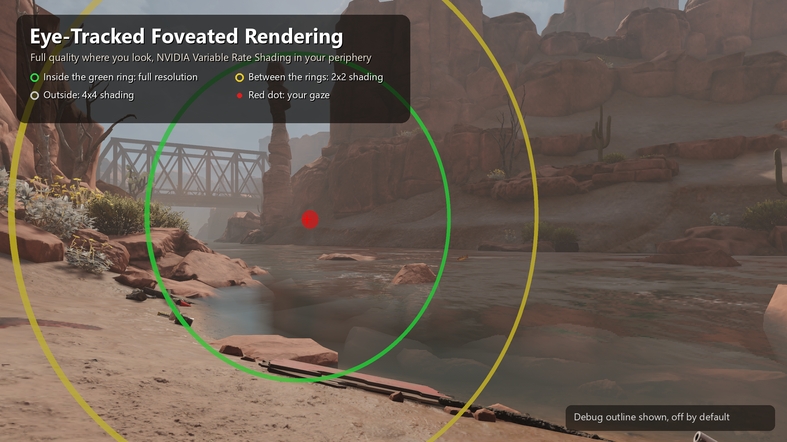
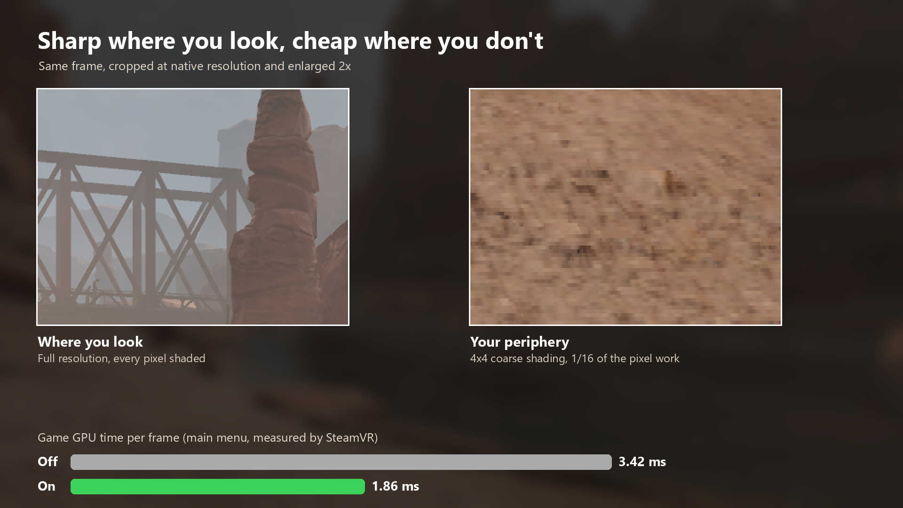

# Foveated Rendering for Arizona Sunshine Remake



Eye-tracked (dynamic) foveated rendering built into the game's own renderer. The area you look at stays at full
quality while the GPU shades your peripheral vision at a quarter or a sixteenth of the pixels. No injector and no
overlay: the mod runs inside the game and only touches the 3D scene passes, so post-processing, UI and text stay clean.

**Download:** [Nexus Mods](https://www.nexusmods.com/arizonasunshineremake/mods/5)



Measured in the main menu: the game's GPU time per frame went from 3.42 ms to 1.86 ms.

## Requirements

- NVIDIA RTX 20xx or newer, or GTX 16xx (Variable Rate Shading on Direct3D 11 through NVAPI). On other GPUs the mod
  stays off.
- An eye-tracked headset whose SteamVR driver provides eye tracking to apps (see below).
- [BepInEx 6 for IL2CPP](https://builds.bepinex.dev/projects/bepinex_be) (build 6.0.0-be.788, win-x64).

Without eye tracking data the game renders at full quality everywhere.

## Supported headsets

The mod reads gaze through SteamVR's standard eye tracking input, the same one SteamVR's OpenXR eye gaze support uses.
It binds that input for every headset type automatically, so any headset whose SteamVR driver publishes eye tracking
should work without configuration.

| Headset | What it needs | Status |
|---|---|---|
| Steam Frame | SteamVR > Settings > Steam Link > enable "Share eye tracking data to other apps on this PC" | Tested |
| PlayStation VR2 | [PSVR2Toolkit](https://github.com/BnuuySolutions/PSVR2Toolkit) installed, eye tracking calibrated in it. Its driver publishes gaze to SteamVR. Note PSVR2Toolkit's terms: its eye tracking data must not be used commercially (this mod is free). | Expected to work, untested |
| Pimax with eye tracking | A driver shim that feeds Pimax eye tracking into SteamVR, such as [Pimax-EyeTracker-SteamVR](https://github.com/mbucchia/Pimax-EyeTracker-SteamVR) | Expected to work, untested |
| Quest Pro and others over Steam Link | Steam Link's eye tracking sharing setting, if your headset and Steam Link version support it | Unknown |
| Vive Pro Eye, Varjo, Virtual Desktop setups | Their eye tracking goes through vendor SDKs or OpenXR runtimes, not SteamVR's input | Not supported without a bridge |

The log tells you what happened. About 8 seconds after entering VR, `BepInEx\LogOutput.log` shows a line like

```
Foveated: headset 'Valve Steam Frame' type 'frame_hmd', advertises eye gaze: yes, gaze action bound to: /user/head/eyetracking (eyetracking)
```

and after 25 seconds without gaze it explains the most likely cause.

If you changed this game's controller bindings in SteamVR before, reset them to the default, or bind the action by
hand: SteamVR > Settings > Controllers > Manage Controller Bindings > Arizona Sunshine Remake > Custom > edit your
headset's binding and bind "Eye gaze" to the headset's eye tracking.

## Installation

Put `AZS1HD.FoveatedRendering.dll` and `AZS1HD.Foveated.Native.dll` in `BepInEx\plugins\AZS1HD.FoveatedRendering\`
(or download the release zip from [Releases](https://github.com/mikael-jarvinen/azs-remake-foveated-rendering/releases)
and extract it into the game folder) and start the game. In VR, `BepInEx\LogOutput.log` shows `receiving eye tracking data`. Set `ShowOutline = true` to
see the foveation rings: red dot = gaze, green = edge of full quality, yellow = edge of 2x2 shading.

## Settings

`BepInEx\config\azs1hd.foveatedrendering.cfg`, created on the first launch:

```ini
[General]
Enabled = true
GazeSource = SteamVR            # SteamVR | Center | Simulated | TestDirection
InnerDegrees = 20               # full quality within this angle of the gaze
MidDegrees = 32                 # 2x2 shading up to this angle, 4x4 beyond
MidRate = 1                     # 1 = 2x2, 3 = 2x1, 4 = 1x2
OuterRate = 2                   # 2 = 4x4, 1 = 2x2
WithoutGaze = FullQuality       # FullQuality | Center
GazeHoldSeconds = 0.4
[Debug]
ShowOutline = false
BenchmarkSeconds = 0            # >0: toggle foveation every N seconds, log GPU ms per frame for each state
VerboseLogging = false
DumpIntervalSeconds = 0         # write BepInEx\foveation_dump.ppm (both eyes, upright) every N seconds
FlipRows = false
TestDirection = -0.35,0.35,-1
GazeActionPath = /actions/Vertigo/in/EyeGaze
```

## Uninstall

Delete `BepInEx\plugins\AZS1HD.FoveatedRendering`. The mod also changed the game's SteamVR input files in
`ArizonaSunshine1hd_Data\StreamingAssets\SteamVR`: it added an eye tracking action, `binding_frame_hmd.json` and
`binding_generic_hmd.json`, and merged an eye tracking entry into the game's headset bindings. These are harmless
without the mod. To undo them, restore each `*.original` file over the file of the same name and delete the two
binding files, or verify the game files in Steam.

## How it works

- **Native module** (`native/foveated.cpp`): hooks `ID3D11DeviceContext::OMSetRenderTargets` on the immediate and
  deferred contexts. A bind with depth and an eye-shaped colour array that is multisampled or HDR is the game's 3D
  scene pass; it gets NVIDIA VRS through NVAPI with a per-eye shading-rate image (16x16 pixel tiles). Every other
  bind turns VRS off, and redundant off-calls are skipped.
- **Angular foveation**: each tile's view direction is precomputed from OpenVR's raw projection, the one Unity renders
  with. A tile is full rate within `InnerDegrees` of the gaze direction, 2x2 within `MidDegrees`, 4x4 beyond.
- **Gaze**: `IVRInput::GetEyeTrackingDataForNextFrame` combined with the compositor's render pose for the same frame
  (`IVRCompositor::GetLastPoses`), converted to a head-space direction. Only the direction is used; the fixation
  distance is noisy.
- **Bindings** (`src/FoveatedRendering/HeadsetBindings.cs`): SteamVR delivers an action only through the app's binding
  for the connected headset type, falling back to the app's `generic_hmd` binding. At plugin load the mod adds the
  `eyetracking` action to the game's action manifest, writes `generic_hmd` and `frame_hmd` bindings, merges the eye
  tracking entry into every headset binding the game ships (those override the fallback), and also binds headset
  types found in the input profiles of installed SteamVR drivers. Game files are backed up as `*.original`.
- **Managed plugin** (`src/FoveatedRendering`): drives the native side every frame from `LateUpdate`, issues a Unity
  render-thread plugin event to refresh the shading-rate images, draws the debug outline as meshes on the head camera,
  and runs the benchmark from SteamVR's `GetFrameTiming`.
- Unity eye textures are bottom-up, OpenVR's raw projection is y-down; the tile mapping accounts for both.

Testing without a headset: enable SteamVR's null driver (`steamvr.vrsettings`: `driver_null.enable = true`,
`steamvr.requireHmd = false`, `steamvr.forcedDriver = "null"`, `steamvr.activateMultipleDrivers = true`), set
`GazeSource = TestDirection` or `Simulated`, `ShowOutline = true` and `DumpIntervalSeconds = 5`, and look at the dump.

## Building

Requirements: Windows, .NET SDK 8 or newer, Visual Studio 2019+ or the Build Tools with the C++ x64 workload, and the
game with BepInEx 6 IL2CPP installed and launched once (the managed project references the generated
`BepInEx\interop` assemblies, which are not part of this repository).

```bat
native\build.bat
cd src\FoveatedRendering
dotnet build -c Release -p:GameDir="C:\Program Files (x86)\Steam\steamapps\common\Arizona Sunshine Remake"
```

Outputs: `native\build\AZS1HD.Foveated.Native.dll` and `src\FoveatedRendering\bin\Release\net6.0\AZS1HD.FoveatedRendering.dll`.
`GameDir` can also come from the `AZS_GAME_DIR` environment variable.

## License

Copyright (C) 2026 Mikael Järvinen.

Licensed under the [GNU General Public License v3.0](LICENSE) with the [additional terms](ADDITIONAL-TERMS.md):
you may modify and redistribute this mod, and versions you distribute must be released under the same license with
their source code, and must keep the credit to the original author. The additional terms also allow the mod to be
used with the game and its proprietary libraries. Third-party components keep their own licenses, see
[THIRD-PARTY-NOTICES.md](THIRD-PARTY-NOTICES.md).

## Credits

Approach informed by fholger's [vrperfkit](https://github.com/fholger/vrperfkit) /
[openvr_foveated](https://github.com/fholger/openvr_foveated), mbucchia's PimaxMagic4All and FarhanTheTinkerer's
[FrameEyePointer](https://github.com/FarhanTheTinkerer/FrameEyePointer).

Unofficial fan mod, not affiliated with or endorsed by Vertigo Games, Valve or NVIDIA.
